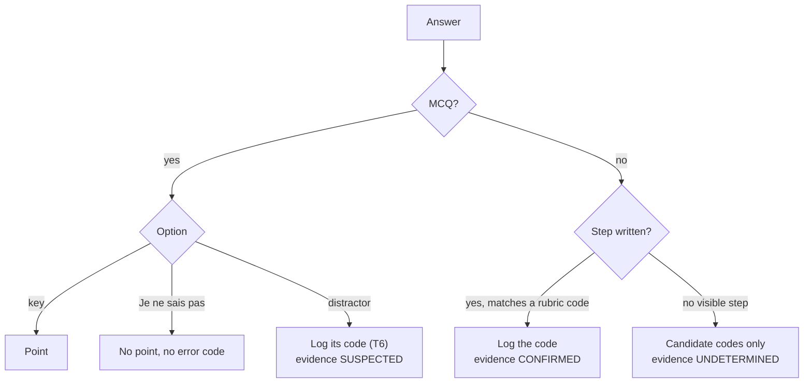

# Handoff — Using a generated diagnostic questionnaire (prompt v10, reference v11)

**Author:** Claude · **Date:** 2026-11-04
**Covers:**
- Part A: validation of `GUIDE_Prompt_Usage_v9_EN.md`, written by Claude CLI.
- Part B: how to use a generated questionnaire, from preparation to follow-up.

---

## Part A — Validation of `GUIDE_Prompt_Usage_v9_EN.md`

**Verdict: VALID WITH CORRECTIONS.** The structure and most of the rules are correct for prompt v9. There are 3 factual errors, 4 items missing since prompt v10, and 2 wording points.

### A.1 Errors

| # | Section | Problem | Correction |
|---|---|---|---|
| E1 | Status warning (top) | "Every row is paper **HOLD** and digital **HOLD**" | 594 rows are `HOLD` and 6 are `FAIL` (`1C-FN-05`…`10`, never usable). |
| E2 | §8, last bullet | "Check the output with `validate_reference_v11.py`" | This validator checks the **reference package**, not a generated quiz. A quiz is checked by the prompt's own tests (T-section) and its **check report** (v10). Keys can be re-verified with SymPy or a second method. |
| E3 | §6, state diagram | `SUSPECTED → CONFIRMED` on "same code on a 2nd surface" | Since v7, two selected distractors alone do **not** confirm a mechanism. Confirmation needs a matching reason, written work, the student's explanation, or a discriminating follow-up item. A repeated code makes the error `RECURRENT`, not `CONFIRMED`. |

### A.2 Missing since prompt v10 (the current prompt)

| # | Add |
|---|---|
| M1 | `{TEST_LENGTH}` = `FULL` / `SHORT` (5–8 items, 10–20 min, default 5 MCQ + 2 open). In `SHORT` mode, Step 3 only checks the rows used. Scenario "Quick Brevet entry test" → `SHORT`. |
| M2 | Three separate statuses:<br>• **row anchor**: `SOURCE_LINKED` / `PROVISIONAL` / `NOT_SUPPORTED` / `CAPABILITY_VERIFIED`;<br>• **row eligibility**: `PASS` / `HOLD` / `FAIL`;<br>• **quiz status**: `UNVALIDATED — HOLD` by default. |
| M3 | Rule 6 adapted to the item count: each code is planted twice only if 2k ≤ N; otherwise it is declared `SINGLE — indicatif`. |
| M4 | Rule 6b: open-question signatures come from `sig_open`, or are recomputed on the open numbers and marked `recomputed`. Add the **check report** that closes every run. |

### A.3 Wording

| # | Section | Change |
|---|---|---|
| W1 | §3 | Add `{EXAM_SESSION}` and `{LEARNER_PROFILE}` (both are in the prompt). |
| W2 | §8 | The gates are **independent**, not a sequence. `LEGACY_MIGRATION_PASS` concerns the reference, not a single quiz. Rename "Status validated" to the quiz status `VALIDATED`. |

**Also add a pitfall:** systems of equations are not in the DNB programme. Items on them are `BRIDGE` (towards 2nde) and must be excluded from an exam simulation.

**Correct as written:**
- variables and level combinations;
- the MPI rule;
- distractor checks S1–S7;
- tables T1–T10;
- skill statuses;
- the 1C derivative pitfall;
- the files list (add v10).

---

## Part B — Using the questionnaire

### B.1 Before the test (teacher, about 15 min)

1. **Check the status line.** It reads `UNVALIDATED — HOLD`, so the quiz is a draft:
   - use it as a classroom diagnostic, never as a mark that counts;
   - remove `BRIDGE` items in exam conditions (e.g. systems at Brevet).
2. **Re-solve 3–4 keys** of your choice. Read every `why` in T6 to check it describes a mistake your students really make.
3. **Print the student version only.** It has no keys or codes. Keep the teacher version separate.
4. **Pseudonymise:** one code per student, such as `E07`. No names in the error log.

### B.2 During the test

| Rule | Why |
|---|---|
| Keep to the planned duration (the time check is in the header) | Times are built in |
| Tell students « Je ne sais pas » is allowed and costs nothing | Separates "not known" from a misconception |
| No help on individual items | Help hides the error |
| Ask students to write intermediate steps on open items | Needed for `CONFIRMED` evidence |

### B.3 Marking and coding (teacher, about 2 min per student)



**Error log:** one CSV line per observed error (reference §2B.5):

```text
date,student_id,test_id,item_id,micro_skill_id,error_id,transversal_tags,points_lost,observed_answer,self_corrected,evidence,status_after,remediation_id
2026-11-05,E07,BRNC-FACT-01,Q8,BR-NC-26,LOCAL-Q8-A,CB-SGN,1,9,N,SUSPECTED,OBSERVED,REM-CB-SGN
```

### B.4 Reading the results

| Per student | Rule |
|---|---|
| Skill status | ✅ / 🟡 / 🟠 / 🔴 by T8. Write "indicatif" if a skill has fewer than 2 items or fewer than 3 points. |
| Error seen in 1 item | `OBSERVED`: a reminder, not a diagnosis |
| Same error in ≥ 2 items | `RECURRENT`: targeted remediation (T10) |
| Misconception | Only with `CONFIRMED` evidence (written step, explanation, or follow-up item) |

**Per class:** the share of students per code. A code above 30 % of the class is worth a whole-class reteach.

### B.5 Follow-up (the next week)

1. For each `RECURRENT` code, run the T10 probe: 1 minute, with new numbers.
2. Correct probe → `RESOLVED` candidate. Re-test 3–4 weeks later before marking it `RESOLVED`.
3. Same error again → `PERSISTENT`: individual remediation.

### B.6 Feedback that improves the reference

After each use, send the following to the maintainer (Claude, Codex or Grok):

| Field | Example |
|---|---|
| Item that did not discriminate | Q4: 100 % right |
| Distractor never chosen | Q19 C |
| Frequent answer with no code | Q13: "x = 3", 6 students |
| Unclear wording | Q16: « élever au carré » misread |
| Anonymised counts per code | `LOCAL-Q8-A`: 11/28 |

This is the pilot evidence that moves an error from `HYPOTHESIS` to `PILOT_SUPPORTED`. Record it in `Item_Review_Register_v11.csv` (`pilot_status`, `pilot_evidence_id`, `pilot_reviewed_on`).

### B.7 From draft to validated quiz

| Step | Who | Where |
|---|---|---|
| Check each row's official BO passage | Teacher | Register: `bo_match`, `bo_page`, `bo_passage`, reviewer, date |
| Approve the items | Teacher | Register: `teacher_item_review = APPROVED`, reviewer, date |
| Review text signatures | Teacher | Register: `YES`, reviewer, date, note |
| Pilot evidence | Teacher + maintainer | Register: pilot fields |
| Re-run the validator | Maintainer | `py -3 -I validate_reference_v11.py` updates the eligibility CSV |
| Digital release only | Maintainer | `Player_Validation_Record_v11.json` |

The quiz becomes `VALIDATED` only when **every item** comes from a `PASS` row and the teacher has approved this quiz.

### B.8 Known limits of the current quizzes

- **Error codes are `LOCAL`.** The next generation should reuse the reference's error IDs (e.g. `BR-NC-26-E1`), recomputed on the item's numbers.
- **The full T3–T10 set is not always produced.** Ask for it explicitly: "produce T3, T4, T7, T8, T10".
