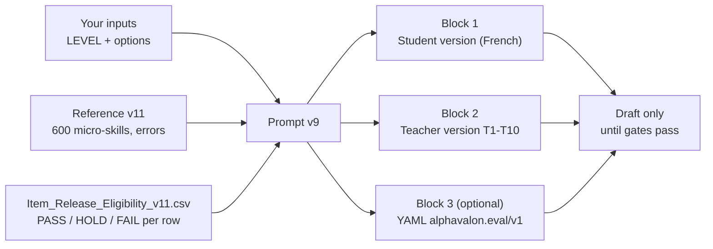
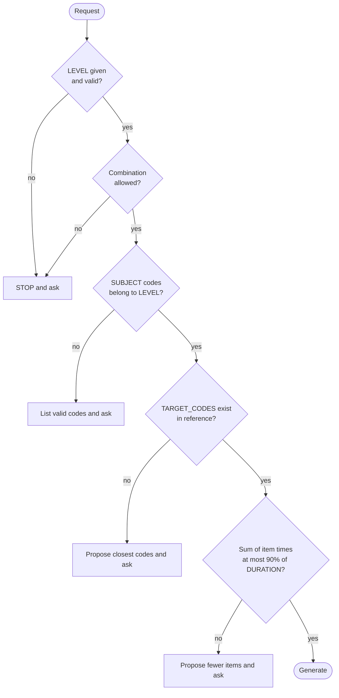
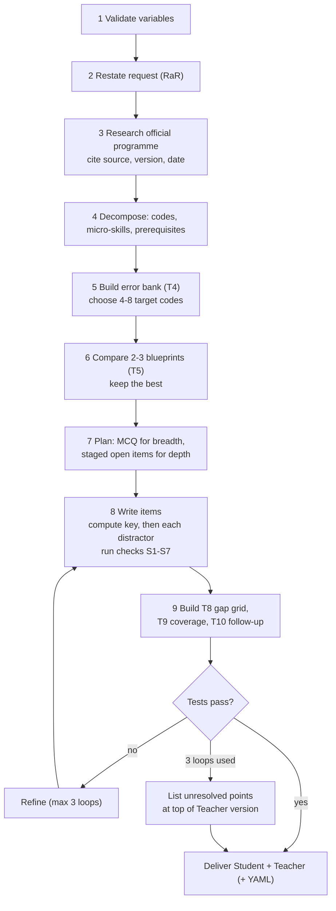
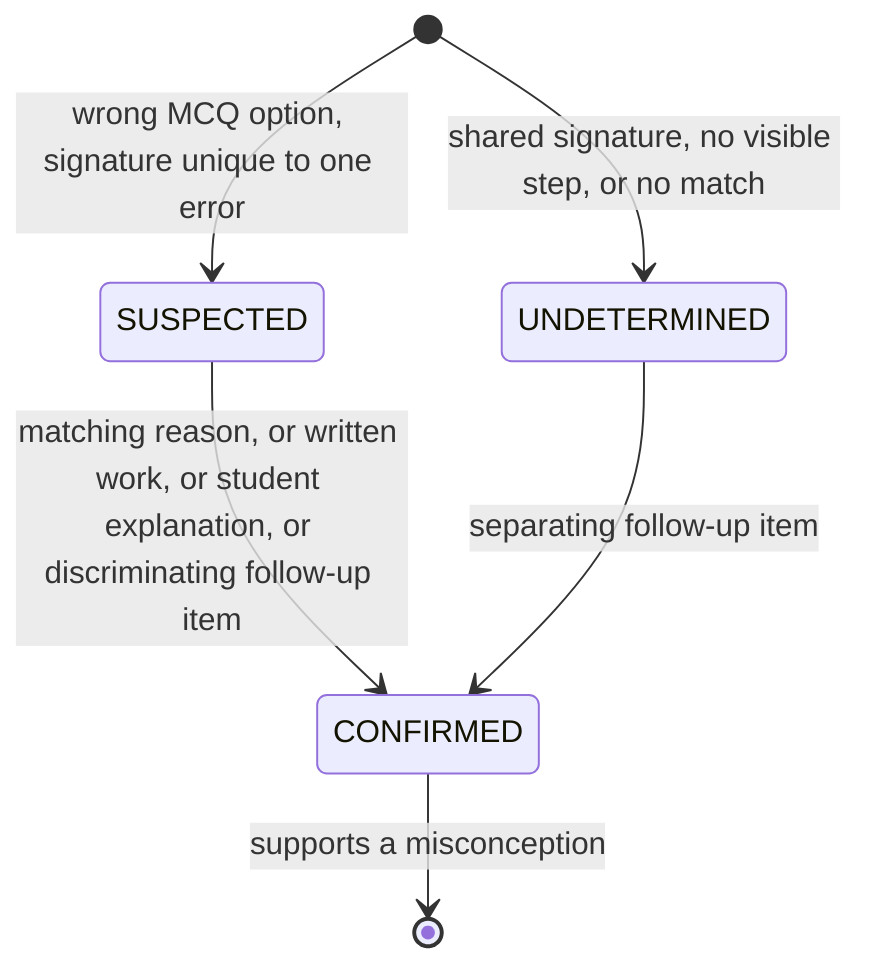
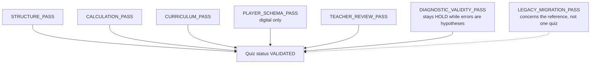
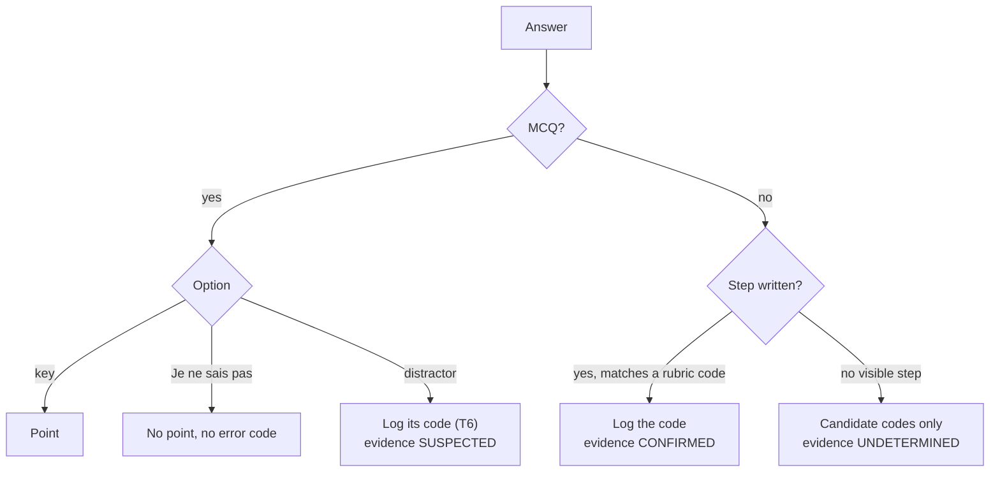
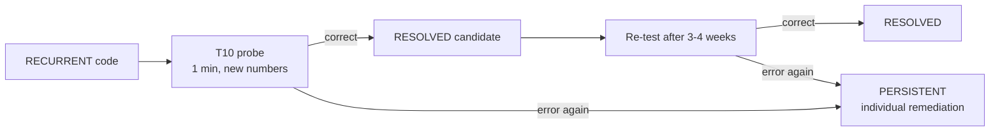

# Using the diagnostic prompt — user guide (v10)

**Version:** 1.1 · 2026-11-04 · **Replaces:** `GUIDE_Prompt_Usage_v9_EN.md` (kept intact)
**Applies to:** the prompt (v9 on disk; v10 per the handoff) with reference v11
**Audience:** teachers and maintainers who want to generate and use a level-and-gap diagnostic.
**Related:** `GUIDE_Math_Diagnostic_v11_Testing_and_HTML_EN.md` (validators and HTML demo), `AGENT_RULES_v11.md`, `HANDOFF_CLAUDE_Questionnaire_Usage_v1.md` (source of the corrections in this version).

> **Status warning:** of the 600 rows of reference v11, 594 are `HOLD` and 6 are `FAIL` (`1C-FN-05`…`10`, never usable); none is `PASS`. Anything generated is a **draft** with *hypothesised* error codes, status `UNVALIDATED — HOLD`. Do not use it as a mark that counts.

> **v10 caveat:** `PROMPT_Diagnostic_Maths_Brevet_Bac_MPI_v10.md` is **not in the repository** (only v9 is). Items marked **[v10 — TO VERIFY]** come from `HANDOFF_CLAUDE_Questionnaire_Usage_v1.md` and must be checked against the v10 file once it is added.

**Changes from guide v9:** fixed the status counts, the validator description and the confirmation rule; added `{TEST_LENGTH}`, the three separate statuses, the check report, a new pitfall, and Part B (using a generated questionnaire).

---

## 1. What the prompt does

Given a level, it produces a **Student version** (no keys, no codes) and a **Teacher version** (tables T1–T10). Each wrong MCQ option and each lost rubric point maps to **one named error code**, so the result says *which mechanism* explains a loss, not only which chapter.



## 2. Quick start

1. Open a new chat in your LLM tool.
2. Paste the **whole** prompt file, then attach `French_Math_Diagnostic_Curriculum_Reference_CLAUDE_EN_v11.md` and, if possible, `Item_Release_Eligibility_v11.csv` and `Math_Diagnostic_Targets_v11.csv`.
3. Add your request, for example:

```text
{LEVEL} = BREVET
{SUBJECT} = BR-NC, BR-DF
{PURPOSE} = Entry diagnostic
{ASSESSMENT_MODE} = DIAGNOSTIC
{DURATION} = 55
{CALCULATOR} = Not allowed
{DELIVERY} = Paper
{OUTPUT_FORMAT} = MARKDOWN
```

4. Read the one-sentence restatement the model returns (RaR). Correct it if wrong, then let it continue.

Only `{LEVEL}` is required. If it is missing or invalid the model must **stop and ask**.

## 3. Input variables

| Variable | Values | Default |
|---|---|---|
| `{LEVEL}` | `BREVET` · `BAC_1RE_SPE` · `BAC_1RE_COMMUN` · `BAC_TLE_SPE` · `BAC_TLE_EXPERTES` · `BAC_TLE_COMPLEMENTAIRES` · `MP2I` · `MPI` | **none (required)** |
| `{SUBJECT}` | `ALL` or sub-domain codes (e.g. `TS-AN, TS-PR`) | `ALL` |
| `{PURPOSE}` | Entry diagnostic · Mid-year check · Pre-exam gap analysis | Entry diagnostic |
| `{ASSESSMENT_MODE}` | `DIAGNOSTIC` · `EXAM_SIMULATION` · `TRAINING` | `DIAGNOSTIC` |
| `{EXAM_SESSION}` | year of the target exam or programme | current school year |
| `{LEARNER_PROFILE}` | e.g. incoming 2nde, 1re spé, Tle → MP2I entry | derived from `{LEVEL}` |
| `{TEST_LENGTH}` **[v10 — TO VERIFY]** | `FULL` · `SHORT` (5–8 items, 10–20 min; default 5 MCQ + 2 open; Step 3 checks only the rows used) | `FULL` |
| `{DURATION}` | minutes | 55 |
| `{NB_MCQ}` / `{NB_OPEN}` | integers | 12 / 3 |
| `{CALCULATOR}` | Allowed · Not allowed · Mixed | Not allowed |
| `{DELIVERY}` | Paper · Digital · Both | Paper |
| `{ADAPTATIONS}` | None · DYS · Extra time (+⅓) · Other | None |
| `{OUTPUT_LANGUAGE}` | language of the questionnaires | French |
| `{TARGET_CODES}` | error codes to probe, or `AUTO` | `AUTO` |
| `{DIAGNOSTIC_OPTIONS}` | `NSP`, `CONFIDENCE`, `TWO_TIER` | `NSP, CONFIDENCE` (paper DIAGNOSTIC) |
| `{OUTPUT_FORMAT}` | `MARKDOWN` · `YAML` · `BOTH` | `MARKDOWN` |
| `{REFERENCE}` | reference file | v11 |

**Valid level combinations:** any single level; `BAC_TLE_SPE` + `BAC_TLE_EXPERTES`; `MP2I` + `MPI`. Everything else (e.g. Expertes alone, Complémentaires + Spécialité, 1re Spé + 1re Commun) is refused and the model asks.



Automatic rules worth knowing:

- **MPI:** at least 20 % of items carry `M1-*` prerequisite codes, plus at least one full proof item and one "find the error" item.
- **EXAM_SIMULATION:** follows the official exam format of `{EXAM_SESSION}` and turns `{DIAGNOSTIC_OPTIONS}` off.
- **YAML:** `NSP` and `CONFIDENCE` stay Markdown-only; `TWO_TIER` becomes two consecutive MCQ items.
- **Time budget:** default 12 MCQ + 3 open ≈ 47.6 min, under the 49.5 min limit for 55 min.

## 4. What happens inside



**Distractor rule (the core idea):** a wrong option is the result of applying one error rule to **this item's own numbers**. Signatures from the reference are never copied onto new numbers.

| Check | Meaning |
|---|---|
| S1 | every value is computed |
| S2 | options are distinct after normalisation |
| S3 | no error rule produces the key (no masking) |
| S4 | one value maps to one error (no collision) |
| S5 | plausible, same format as the key |
| S6 | no padding: MCQ only from `MCQ+OPEN` rows; `LOCAL` only for a real mechanism |
| S7 | keys spread over A–D, no letter above 40 % |

Further rules **[v10 — TO VERIFY]**:

- **Rule 6 (target codes):** a code is planted twice only if 2k ≤ N items; otherwise it is declared `SINGLE — indicatif`.
- **Rule 6b (open items):** open-question signatures come from `sig_open`, or are recomputed on the open numbers and marked `recomputed`.
- **Check report:** every run ends with a check report (keys re-solved, S1–S7 results, time check). Ask for it if it is missing.

## 5. Reading the output

**Student version:** header, Part A (MCQ with optional "Je ne sais pas" and "Sûr / Pas sûr"), Part B (open questions, at least one error-finding item in DIAGNOSTIC mode). It contains no key, rubric or code.

**Teacher version:**

| Table | Content |
|---|---|
| T1 | sources, version, URL, consultation date |
| T2 | documented tools only |
| T3 | skills map with eligibility and anchor status |
| T4 | error bank, signatures on this item's numbers |
| T5 | blueprint comparison and target-code coverage |
| T6 | MCQ keys: per option value → code → `why` |
| T7 | open solutions, rubric with a code on every criterion |
| T8 | gap-diagnosis grid |
| T9 | coverage matrix (selected blueprint only) |
| T10 | follow-up probes per observed code |

Anything marked `[TO VERIFY]` or `[ANCHOR TO VERIFY]` is excluded from final keys until checked against the official text.

## 6. Interpreting student results

Skill status (needs ≥ 2 items or ≥ 3 points, otherwise write "indicatif"):

| Status | Rule |
|---|---|
| ✅ Acquired | ≥ 80 % and no `RECURRENT` code |
| 🟡 Partial, specific pattern | 50–79 %, or ≥ 30 % with errors concentrated on one code |
| 🟠 Fragile | 30–49 %, scattered errors |
| 🔴 Not acquired | < 30 %, or mostly "Je ne sais pas" |

Evidence states for each logged error code:



Rules: only `CONFIRMED` supports a misconception. Two selected distractors alone do **not** confirm a mechanism. A code seen once is `OBSERVED`; in two or more items it is `RECURRENT` (a repeat does not make it `CONFIRMED`); "Je ne sais pas" is never an error code; never assign a code to a lost rubric point if the step is not written.

## 7. Common scenarios

| Goal | Inputs |
|---|---|
| Quick Brevet entry test | `BREVET`, `{TEST_LENGTH} = SHORT` **[v10 — TO VERIFY]** (on v9: `{NB_MCQ} = 5`, `{NB_OPEN} = 2`, `{DURATION} = 20`) |
| Full Brevet entry test | `BREVET`, `ALL`, defaults |
| Probe specific errors | add `{TARGET_CODES} = CB-SGN-05, CB-PRB-01`; each is planted in ≥ 2 items |
| Digital player file | `{OUTPUT_FORMAT} = YAML` (or `BOTH`); validate with the real player schema |
| Real exam rehearsal | `{ASSESSMENT_MODE} = EXAM_SIMULATION`, `{EXAM_SESSION} = 2028` |
| CPGE entry | `MP2I`, or `MP2I` + `MPI` for MPI with prerequisite check |
| DYS adaptation | `{ADAPTATIONS} = DYS` (layout rules apply to the student version) |

## 8. Statuses and release

Three separate statuses **[v10 — TO VERIFY]**:

| Status of | Values |
|---|---|
| Row **anchor** | `SOURCE_LINKED` · `PROVISIONAL` · `NOT_SUPPORTED` · `CAPABILITY_VERIFIED` |
| Row **eligibility** | `PASS` · `HOLD` · `FAIL` (paper and digital separate) |
| **Quiz** | `UNVALIDATED — HOLD` by default; `VALIDATED` only as in section 12 |

The seven release gates are **independent checks, not a sequence**:



- A `VALIDATED` quiz uses only rows with `eligibility_paper = PASS` (paper) or `eligibility_digital = PASS` (digital, plus `Player_Validation_Record_v11.json`).
- `HOLD` rows give `draft` items with the reasons listed; `FAIL` rows are never used.
- `validate_reference_v11.py` checks the **reference package**, not a generated quiz. A zero-blocking run is a structural pass, not pedagogical approval.
- A generated quiz is checked by the prompt's own tests and its check report; re-verify keys with SymPy or a second method.

## 9. Pitfalls

| Pitfall | Do this instead |
|---|---|
| Omitting `{LEVEL}` | Always give it; the model must stop otherwise |
| Treating error codes as diagnoses | They are hypotheses (`research_status = HYPOTHESIS`) |
| Using `BAC_1RE_COMMUN` for derivation | Not in the 2026 programme; `1C-FN-05`…`10` are `FAIL` (never usable; anchor `NOT_SUPPORTED`). The reference §1.2 item 32 still says `HOLD`: the eligibility CSV is authoritative |
| Asking for more items than the time allows | Keep Σ times ≤ 90 % of duration |
| Pasting the prompt without the reference | Attach v11; otherwise row details become `[TO VERIFY]` |
| Systems of equations in a Brevet exam simulation | Not in the DNB programme: such items are `BRIDGE` (towards 2nde); exclude them **[v10 — TO VERIFY]** |
| Calling the output "validated" | Only as in section 12 |
| Overwriting the prompt after a change | Create `_v10`; never overwrite a published version |

## 10. Files

| File | Role |
|---|---|
| `PROMPT_Diagnostic_Maths_Brevet_Bac_MPI_v9.md` | the prompt on disk (v10 not yet in the repo) |
| `HANDOFF_CLAUDE_Questionnaire_Usage_v1.md` | validation of guide v9 and usage procedure |
| `French_Math_Diagnostic_Curriculum_Reference_CLAUDE_EN_v11.md` | curriculum and error reference |
| `Math_Diagnostic_Targets_v11.csv` | one row per micro-skill, errors as JSON |
| `Item_Release_Eligibility_v11.csv` | PASS / HOLD / FAIL per row |
| `validation_report_v11.txt` | latest validator output |
| `GUIDE_Math_Diagnostic_v11_Testing_and_HTML_EN.md` | tests and HTML demo |

---

# Part B — Using a generated questionnaire

## 11. Test day to follow-up

### 11.1 Before the test (teacher, about 15 min)

1. **Check the status line.** `UNVALIDATED — HOLD` means draft: use it as a classroom diagnostic, never as a mark that counts. Remove `BRIDGE` items in exam conditions (e.g. systems at Brevet).
2. **Re-solve 3–4 keys** of your choice and read every `why` in T6: it must describe a mistake your students really make.
3. **Print the student version only.** Keep the teacher version separate.
4. **Pseudonymise:** one code per student (e.g. `E07`); no names in the error log.

### 11.2 During the test

| Rule | Why |
|---|---|
| Keep to the planned duration (time check in the header) | Times are built in |
| Say « Je ne sais pas » is allowed and costs nothing | Separates "not known" from a misconception |
| No help on individual items | Help hides the error |
| Ask for intermediate steps on open items | Needed for `CONFIRMED` evidence |

### 11.3 Marking and coding (about 2 min per student)



One CSV line per observed error (reference §2B.5):

```text
date,student_id,test_id,item_id,micro_skill_id,error_id,transversal_tags,points_lost,observed_answer,self_corrected,evidence,status_after,remediation_id
2026-11-05,E07,BRNC-FACT-01,Q8,BR-NC-26,LOCAL-Q8-A,CB-SGN,1,9,N,SUSPECTED,OBSERVED,REM-CB-SGN
```

### 11.4 Reading the results

| Per student | Rule |
|---|---|
| Skill status | ✅ / 🟡 / 🟠 / 🔴 by T8; "indicatif" below 2 items or 3 points |
| Error in 1 item | `OBSERVED`: a reminder, not a diagnosis |
| Same error in ≥ 2 items | `RECURRENT`: targeted remediation (T10) |
| Misconception | Only with `CONFIRMED` evidence |

**Per class:** share of students per code; above 30 % is worth a whole-class reteach.

### 11.5 Follow-up (next week)



### 11.6 Feedback that improves the reference

After each use, send the maintainer: non-discriminating items (e.g. Q4 100 % right), distractors never chosen, frequent answers with no code, unclear wording, and **anonymised** counts per code (e.g. `LOCAL-Q8-A`: 11/28). This is the pilot evidence that can move an error from `HYPOTHESIS` to `PILOT_SUPPORTED`; record it in `Item_Review_Register_v11.csv` (`pilot_status`, `pilot_evidence_id`, `pilot_reviewed_on`).

## 12. From draft to `VALIDATED`

| Step | Who | Where |
|---|---|---|
| Check each row's official BO passage | Teacher | Register: `bo_match`, `bo_page`, `bo_passage`, reviewer, date |
| Approve the items | Teacher | Register: `teacher_item_review = APPROVED`, reviewer, date |
| Review text signatures | Teacher | Register: `YES`, reviewer, date, note |
| Pilot evidence | Teacher + maintainer | Register: pilot fields |
| Re-run the validator | Maintainer | `py -3 -I validate_reference_v11.py` updates the eligibility CSV |
| Digital release only | Maintainer | `Player_Validation_Record_v11.json` |

The quiz becomes `VALIDATED` only when **every item** comes from a `PASS` row and the teacher has approved this quiz.

## 13. Known limits of current quizzes

- **Error codes are `LOCAL`.** The next generation should reuse the reference's error IDs (e.g. `BR-NC-26-E1`), recomputed on the item's numbers.
- **The full T3–T10 set is not always produced.** Ask explicitly: "produce T3, T4, T7, T8, T10".
- **Confirmation rule differs between documents.** This guide and the handoff say a repeated code gives `RECURRENT`, not `CONFIRMED`. Reference §2C.6a and prompt v9 still list "same code in a second item with a different surface" as a path to `CONFIRMED`. Follow this guide until the reference and prompt are updated to match.
- The v10 prompt file is not in the repo; section 3, 4 and 8 items marked **[v10 — TO VERIFY]** stay unconfirmed until it is added.
