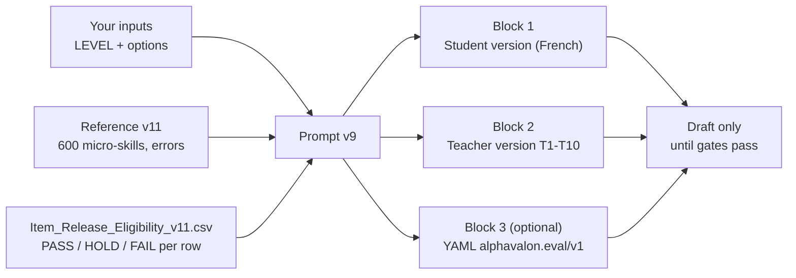
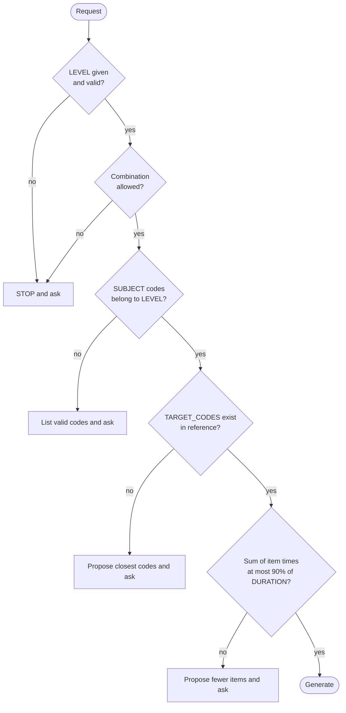
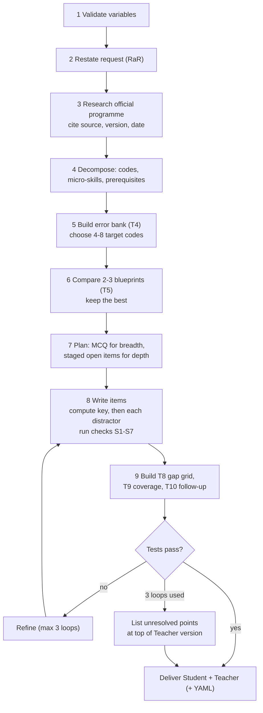
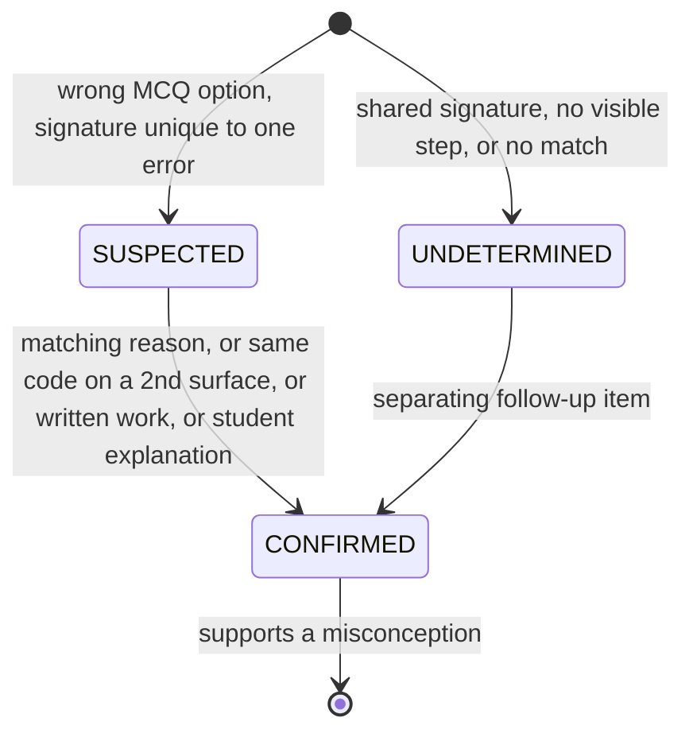
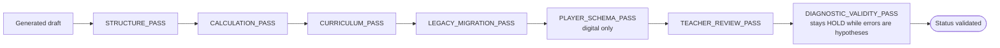

# Using the diagnostic prompt v9 — user guide

**Version:** 1.0 · 2026-11-04 · **Applies to:** `PROMPT_Diagnostic_Maths_Brevet_Bac_MPI_v9.md` with reference v11
**Audience:** teachers and maintainers who want to generate a level-and-gap diagnostic.
**Related:** `GUIDE_Math_Diagnostic_v11_Testing_and_HTML_EN.md` (running the validators and HTML demo), `AGENT_RULES_v11.md`.

> **Status warning:** every row of reference v11 is currently paper **HOLD** and digital **HOLD**. Anything generated is a **draft** with *hypothesised* error codes. Do not give it to students without the release gates in section 8.

---

## 1. What the prompt does

Given a level, it produces a **Student version** (no keys, no codes) and a **Teacher version** (tables T1–T10). Each wrong MCQ option and each lost rubric point maps to **one named error code**, so the result says *which mechanism* explains a loss, not only which chapter.



## 2. Quick start

1. Open a new chat in your LLM tool.
2. Paste the **whole** prompt file, then attach `French_Math_Diagnostic_Curriculum_Reference_CLAUDE_EN_v11.md` and, if possible, `Item_Release_Eligibility_v11.csv` and `Math_Diagnostic_Targets_v11.csv`.
3. Add your request, for example:

```text
{LEVEL} = BREVET
{SUBJECT} = BR-NC, BR-DF
{PURPOSE} = Entry diagnostic
{ASSESSMENT_MODE} = DIAGNOSTIC
{DURATION} = 55
{CALCULATOR} = Not allowed
{DELIVERY} = Paper
{OUTPUT_FORMAT} = MARKDOWN
```

4. Read the one-sentence restatement the model returns (RaR). Correct it if wrong, then let it continue.

Only `{LEVEL}` is required. If it is missing or invalid the model must **stop and ask**.

## 3. Input variables

| Variable | Values | Default |
|---|---|---|
| `{LEVEL}` | `BREVET` · `BAC_1RE_SPE` · `BAC_1RE_COMMUN` · `BAC_TLE_SPE` · `BAC_TLE_EXPERTES` · `BAC_TLE_COMPLEMENTAIRES` · `MP2I` · `MPI` | **none (required)** |
| `{SUBJECT}` | `ALL` or sub-domain codes (e.g. `TS-AN, TS-PR`) | `ALL` |
| `{PURPOSE}` | Entry diagnostic · Mid-year check · Pre-exam gap analysis | Entry diagnostic |
| `{ASSESSMENT_MODE}` | `DIAGNOSTIC` · `EXAM_SIMULATION` · `TRAINING` | `DIAGNOSTIC` |
| `{DURATION}` | minutes | 55 |
| `{NB_MCQ}` / `{NB_OPEN}` | integers | 12 / 3 |
| `{CALCULATOR}` | Allowed · Not allowed · Mixed | Not allowed |
| `{DELIVERY}` | Paper · Digital · Both | Paper |
| `{ADAPTATIONS}` | None · DYS · Extra time (+⅓) · Other | None |
| `{OUTPUT_LANGUAGE}` | language of the questionnaires | French |
| `{TARGET_CODES}` | error codes to probe, or `AUTO` | `AUTO` |
| `{DIAGNOSTIC_OPTIONS}` | `NSP`, `CONFIDENCE`, `TWO_TIER` | `NSP, CONFIDENCE` (paper DIAGNOSTIC) |
| `{OUTPUT_FORMAT}` | `MARKDOWN` · `YAML` · `BOTH` | `MARKDOWN` |
| `{REFERENCE}` | reference file | v11 |

**Valid level combinations:** any single level; `BAC_TLE_SPE` + `BAC_TLE_EXPERTES`; `MP2I` + `MPI`. Everything else (e.g. Expertes alone, Complémentaires + Spécialité, 1re Spé + 1re Commun) is refused and the model asks.



Automatic rules worth knowing:

- **MPI:** at least 20 % of items carry `M1-*` prerequisite codes, plus at least one full proof item and one "find the error" item.
- **EXAM_SIMULATION:** follows the official exam format of `{EXAM_SESSION}` and turns `{DIAGNOSTIC_OPTIONS}` off.
- **YAML:** `NSP` and `CONFIDENCE` stay Markdown-only; `TWO_TIER` becomes two consecutive MCQ items.
- **Time budget:** default 12 MCQ + 3 open ≈ 47.6 min, under the 49.5 min limit for 55 min.

## 4. What happens inside



**Distractor rule (the core idea):** a wrong option is the result of applying one error rule to **this item's own numbers**. Signatures from the reference are never copied onto new numbers.

| Check | Meaning |
|---|---|
| S1 | every value is computed |
| S2 | options are distinct after normalisation |
| S3 | no error rule produces the key (no masking) |
| S4 | one value maps to one error (no collision) |
| S5 | plausible, same format as the key |
| S6 | no padding: MCQ only from `MCQ+OPEN` rows; `LOCAL` only for a real mechanism |
| S7 | keys spread over A–D, no letter above 40 % |

## 5. Reading the output

**Student version:** header, Part A (MCQ with optional "Je ne sais pas" and "Sûr / Pas sûr"), Part B (open questions, at least one error-finding item in DIAGNOSTIC mode). It contains no key, rubric or code.

**Teacher version:**

| Table | Content |
|---|---|
| T1 | sources, version, URL, consultation date |
| T2 | documented tools only |
| T3 | skills map with eligibility and anchor status |
| T4 | error bank, signatures on this item's numbers |
| T5 | blueprint comparison and target-code coverage |
| T6 | MCQ keys: per option value → code → `why` |
| T7 | open solutions, rubric with a code on every criterion |
| T8 | gap-diagnosis grid |
| T9 | coverage matrix (selected blueprint only) |
| T10 | follow-up probes per observed code |

Anything marked `[TO VERIFY]` or `[ANCHOR TO VERIFY]` is excluded from final keys until checked against the official text.

## 6. Interpreting student results

Skill status (needs ≥ 2 items or ≥ 3 points, otherwise write "indicatif"):

| Status | Rule |
|---|---|
| ✅ Acquired | ≥ 80 % and no `RECURRENT` code |
| 🟡 Partial, specific pattern | 50–79 %, or ≥ 30 % with errors concentrated on one code |
| 🟠 Fragile | 30–49 %, scattered errors |
| 🔴 Not acquired | < 30 %, or mostly "Je ne sais pas" |

Evidence states for each logged error code:



Rules: only `CONFIRMED` supports a misconception; a code seen once is `OBSERVED`, in two or more items `RECURRENT`; "Je ne sais pas" is never an error code; never assign a code to a lost rubric point if the step is not written.

## 7. Common scenarios

| Goal | Inputs |
|---|---|
| Quick Brevet entry test | `BREVET`, `ALL`, defaults |
| Probe specific errors | add `{TARGET_CODES} = CB-SGN-05, CB-PRB-01`; each is planted in ≥ 2 items |
| Digital player file | `{OUTPUT_FORMAT} = YAML` (or `BOTH`); validate with the real player schema |
| Real exam rehearsal | `{ASSESSMENT_MODE} = EXAM_SIMULATION`, `{EXAM_SESSION} = 2028` |
| CPGE entry | `MP2I`, or `MP2I` + `MPI` for MPI with prerequisite check |
| DYS adaptation | `{ADAPTATIONS} = DYS` (layout rules apply to the student version) |

## 8. From draft to release



- A `validated` quiz uses only rows with `eligibility_paper = PASS` (paper) or `eligibility_digital = PASS` (digital, plus `Player_Validation_Record_v11.json`).
- `HOLD` rows give `draft` items with the reasons listed; `FAIL` rows are never used.
- A validator run with zero blocking findings is a **structural pass**, not pedagogical approval.
- Check the output with `py -3 -I validate_reference_v11.py` and the procedure in the testing guide.

## 9. Pitfalls

| Pitfall | Do this instead |
|---|---|
| Omitting `{LEVEL}` | Always give it; the model must stop otherwise |
| Treating error codes as diagnoses | They are hypotheses (`research_status = HYPOTHESIS`) |
| Using `BAC_1RE_COMMUN` for derivation | Not in the 2026 programme; `1C-FN-05`…`10` are `HOLD` |
| Asking for more items than the time allows | Keep Σ times ≤ 90 % of duration |
| Pasting the prompt without the reference | Attach v11; otherwise row details become `[TO VERIFY]` |
| Calling the output "validated" | Only after all gates in section 8 |
| Overwriting the prompt after a change | Create `_v10`; never overwrite a published version |

## 10. Files

| File | Role |
|---|---|
| `PROMPT_Diagnostic_Maths_Brevet_Bac_MPI_v9.md` | the prompt |
| `French_Math_Diagnostic_Curriculum_Reference_CLAUDE_EN_v11.md` | curriculum and error reference |
| `Math_Diagnostic_Targets_v11.csv` | one row per micro-skill, errors as JSON |
| `Item_Release_Eligibility_v11.csv` | PASS / HOLD / FAIL per row |
| `validation_report_v11.txt` | latest validator output |
| `GUIDE_Math_Diagnostic_v11_Testing_and_HTML_EN.md` | tests and HTML demo |
